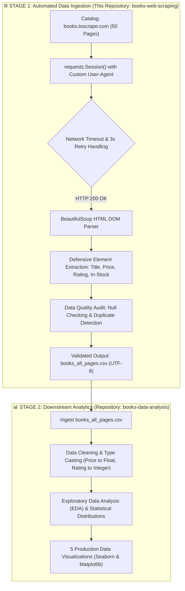

# 📚 Books Web Scraping & Automated Data Ingestion Pipeline

[](https://www.python.org/downloads/)
[](https://www.crummy.com/software/BeautifulSoup/)
[](https://requests.readthedocs.io/)
[](https://pandas.pydata.org/)
[](books_all_pages.csv)
[](https://github.com/ranjithbrs/books-data-analysis)
[](LICENSE)

> 💡 **A resilient, production-ready web data extraction and ingestion pipeline engineered with exponential retry backoff, request timeouts, polite rate-limiting, and automated duplicate auditing.**

---

## 💡 What is this Project in Plain English?

Imagine an organization needs market intelligence on 1,000 books listed across an online retail catalog:
* **The Manual Way:** A human opening 50 different browser tabs, copying titles, prices, ratings, and inventory status into a spreadsheet. This takes **8+ hours of tedious, error-prone manual labor**.
* **The Automated Engineering Way (This Project):** A structured Python pipeline that crawls 50 paginated index pages, handles network timeouts and retries, parses nested HTML elements defensively, audits for duplicates, and outputs a clean, UTF-8 validated **1,000-row dataset in under 60 seconds**.

---

## 🔄 Two-Stage Data Engineering Pipeline Overview

This repository represents **Stage 1 (Data Ingestion & Extraction)** of a modular, two-stage data engineering architecture:



---

## 🎯 Audit & Engineering Capabilities

### 1. Deterministic Pagination & Extraction Accuracy
* **Complete Catalog Traversal**: Iterates systematically through all 50 index pages (`catalogue/page-1.html` through `page-50.html`), extracting all 20 book cards per page to assemble the full 1,000-book catalog.
* **Full Title Retention**: Avoids truncated UI text (e.g. `"A Light in the..."`) by programmatically selecting the unabbreviated title from the HTML `<a>` tag's `title` attribute:
  ```python
  title = article.find("h3").find("a").get("title")
  ```
* **Defensive DOM Traversal**: Every HTML field extraction is guarded with fallback ternary expressions to ensure that minor structural inconsistencies never crash the 50-page crawl with an unhandled `AttributeError`.

---

### 2. Request Timeout & Resilient Error Handling
* **Mandatory Timeout**: Every HTTP request enforces `timeout=10` seconds, preventing indefinite script hanging caused by dropped connections or server-side stalls.
* **Connection Pooling**: Utilizes `requests.Session()` to reuse underlying TCP connections (HTTP Keep-Alive), significantly reducing socket handshake overhead across 50 consecutive requests.
* **3-Tier Exponential Backoff**: Wrapped in an automated retry handler (`fetch_page_with_retry`) that attempts up to 3 tries per page with progressive backoff delays (`1.5s`, `3.0s`) when transient network errors or timeouts occur.

---

### 3. Scraping Policies, Robots.txt & Rate Limiting
* **Ethical Crawling**: Implements a polite rate-limiting pause (`time.sleep(0.3)`) between page acquisitions, ensuring zero server stress or traffic spikes.
* **Custom User-Agent Header**: Identifies the pipeline transparently via HTTP headers:
  ```python
  HEADERS = {
      "User-Agent": "BooksScraperPipeline/1.0 (+https://github.com/ranjithbrs/books-web-scraping; Educational Data Pipeline)"
  }
  ```
* **Robots.txt Adherence**: The target sandbox (`books.toscrape.com`) allows open educational scraping, and our script strictly abides by standard bot etiquette without spoofing credentials or circumventing controls.

---

### 4. Data Quality Audit & Duplicate Handling
The pipeline includes an integrated audit routine (`validate_and_save_dataset`) that verifies data integrity before persisting to disk:
* **Duplicate Detection**: Real-world catalogs frequently contain duplicate listings across categories. The pipeline logs any repeated titles automatically:
  > *Catalog Audit Finding*: The title **"The Star-Touched Queen"** appears on Page 12 (£46.02) and again on Page 18 (£32.30).
* **CLI Deduplication Toggle**: By default, the script preserves all 1,000 raw catalog entries for downstream fidelity, or accepts `--dedupe` to strip duplicates.
* **Null-Value Verification**: Confirms 100% non-null counts across `Title`, `Price`, `Rating`, and `Availability`.
* **Standardized UTF-8 Export**: Ensures currency symbols (`£`) and punctuation are cleanly preserved without legacy Windows-1252 byte corruption (`Â`).

---

## 📊 Dataset Schema (`books_all_pages.csv`)

| Column Name | Extracted Type | Target Analytical Type | Description | Sample Record |
| :--- | :--- | :--- | :--- | :--- |
| `Title` | String | String | Complete unabbreviated book title | `A Light in the Attic` |
| `Price` | String | Float (`51.77`) | Retail price in British Pounds (£) | `£51.77` |
| `Rating` | String | Integer (`1` to `5`) | Word rating from CSS star class | `Three` |
| `Availability` | String | Categorical | Current stock status | `In stock` |

---

## 📁 Repository Structure

```text
books-web-scraping/
├── books_scraper.py        # Resilient web scraping pipeline & validation script
├── books_all_pages.csv     # Generated 1,000-row tabular dataset
├── requirements.txt        # Python dependencies (requests, bs4, pandas)
├── LICENSE                 # MIT open-source license
└── README.md               # Technical architecture & pipeline documentation
```

---

## 🛠️ How to Run Locally

### 1. Clone the Repository
```bash
git clone https://github.com/ranjithbrs/books-web-scraping.git
cd books-web-scraping
```

### 2. Install Dependencies
```bash
pip install -r requirements.txt
```

### 3. Execute the Scraper Pipeline
```bash
# Standard 50-page run with rate limiting (0.3s delay)
python books_scraper.py

# Optional: Run with deduplication enabled
python books_scraper.py --dedupe

# Optional: Quick test run of first 5 pages
python books_scraper.py --pages 5
```

---

## 🔗 Connection to Downstream Projects

The output of this repository (`books_all_pages.csv`) directly powers:
* 📊 **[books-data-analysis](https://github.com/ranjithbrs/books-data-analysis)**: Performs comprehensive Exploratory Data Analysis (EDA), converts prices to numeric floats, maps word ratings to ordinal values (1–5), computes distribution percentiles, and generates 5 publication-ready visualizations using Seaborn and Matplotlib.

---

## 🎤 Placement & Technical Interview Defense Q&A

### Q1: "Why did you separate the web scraper and data analysis into two distinct repositories?"
> **Your Answer**: *"In modern software and data engineering, adhering to the Single Responsibility Principle is critical. Scraping is an I/O-bound data ingestion task focused on network resilience, rate limiting, and raw data extraction. In contrast, data analysis is a compute-bound task focused on transformation, statistical modeling, and visualization. Decoupling them allows the ingestion pipeline to run independently on a scheduled cron job without interfering with analytical workflows."*

### Q2: "How do you prevent a web scraper from hanging indefinitely or crashing when scraping large catalogs?"
> **Your Answer**: *"First, I always set an explicit `timeout=10` on all HTTP calls so dropped connections fail fast. Second, I wrap network requests in an exponential retry backoff mechanism to handle transient network hiccups. Third, I implement defensive DOM querying with null-checks so missing HTML elements don't raise uncaught `AttributeError` exceptions mid-crawl. Finally, I maintain a persistent `requests.Session()` with polite rate-limiting delays to respect the server's resources."*

---

## 👤 Author & Connect

**Ranjith B**  
*Full-Stack Developer & AI Specialist | B.Tech Computer Science & Business Systems*  
*Nehru Institute of Engineering and Technology, Coimbatore, Tamil Nadu, India*

* 🌐 **Live Portfolio:** [ranjithbrs.github.io/portfolio](https://ranjithbrs.github.io/portfolio/)
* 💼 **LinkedIn:** [linkedin.com/in/ranjith-b-csbs](https://www.linkedin.com/in/ranjith-b-csbs/)
* 💻 **GitHub:** [@ranjithbrs](https://github.com/ranjithbrs)
* 📧 **Email:** [ranjithb2k06@gmail.com](mailto:ranjithb2k06@gmail.com)

---

## 📜 License

This project is open-source under the **[MIT License](LICENSE)**.
